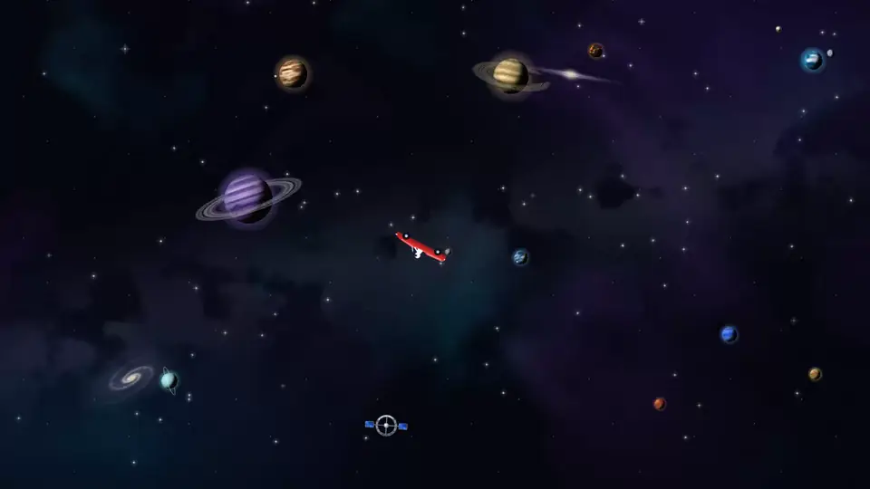
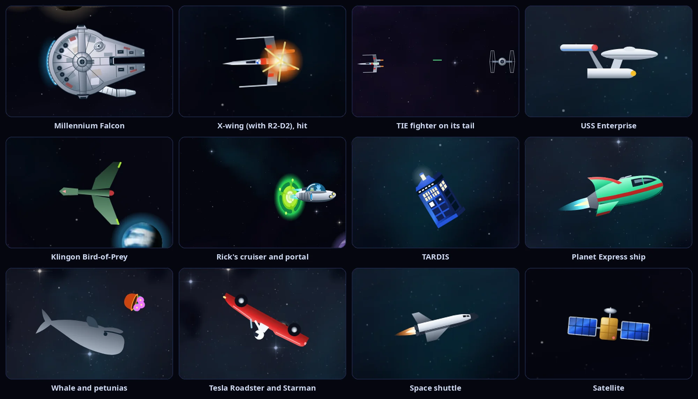
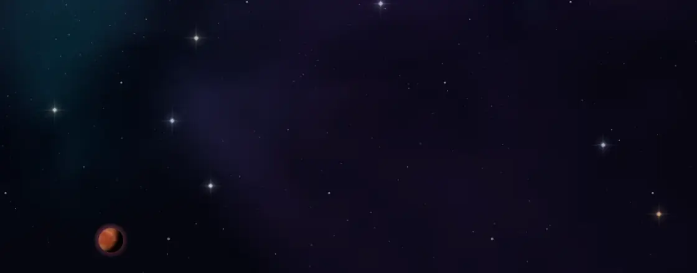
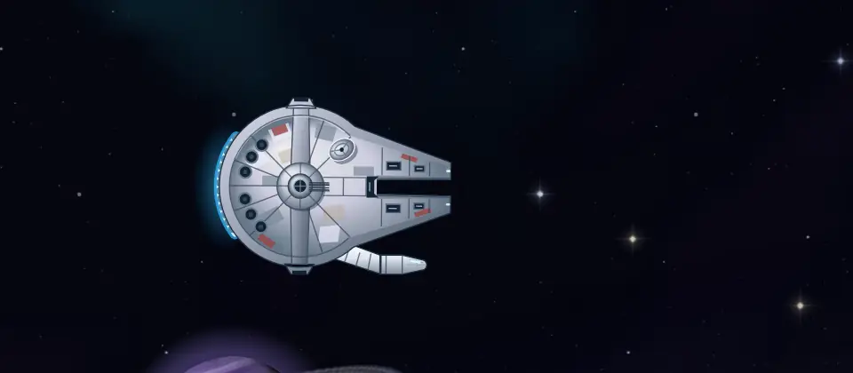
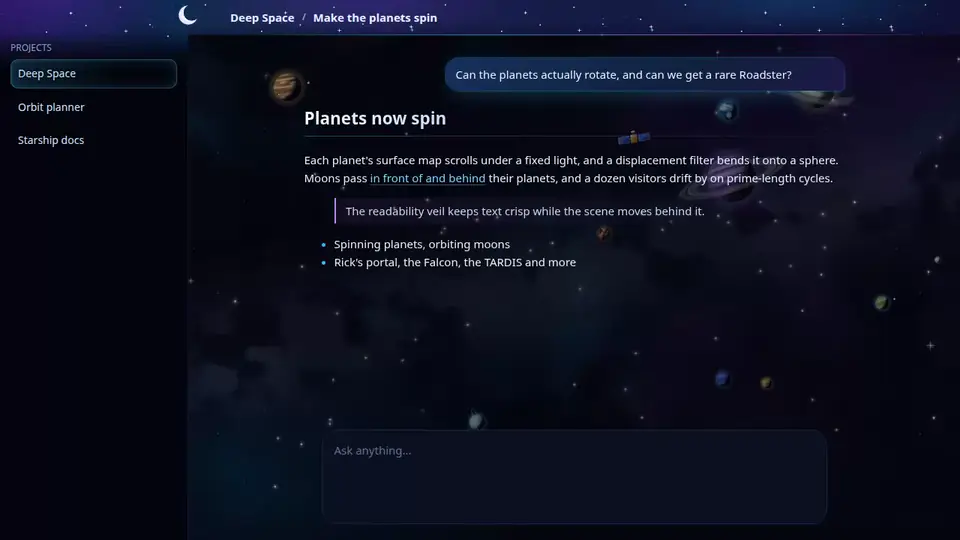

<div align="center">


# Deep Space

**A living solar system for [T3 Code](https://t3.codes).**

Spinning planets, breathing nebulae, orbiting moons and a rotating cast of visitors, from a lost satellite to the Millennium Falcon.<br>
It's all CSS and SVG, with no JavaScript, and it stays behind a readability veil so your code and chat stay crisp.

[](https://t3.codes)
[](#how-it-fits-in-one-css-file)
[](#how-it-fits-in-one-css-file)
[](LICENSE)

[Install](#install) · [The sky](#the-sky) · [The visitors](#the-visitors) · [The app](#the-app) · [Build from source](#build-from-source)



</div>

## Install

You need **T3 Code Nightly from 2026-11-21 or later**. Older builds have a smaller theme size limit.

**macOS and Linux:**

```sh
mkdir -p ~/.t3/userdata/themes && cd ~/.t3/userdata/themes
for f in json webp; do
  curl -fsSLO https://raw.githubusercontent.com/0hmslice/t3-deep-space/main/themes/deep-space.$f
done
```

Then pick **Deep Space** in T3 Code's theme settings. If it was already selected, switch to another theme and back to load the new version.

<details>
<summary>Manual install</summary>

1. Download [`themes/deep-space.json`](themes/deep-space.json) and [`themes/deep-space.webp`](themes/deep-space.webp).
2. Put both in `~/.t3/userdata/themes/`.
3. Pick **Deep Space** in T3 Code's theme settings.

You can also drop `deep-space.json` onto **Add theme** in T3 Code. The `.webp` is the starfield behind the scene, and T3 loads it from the themes folder when it has the same base name as the theme file. Without it, the theme still works over a plain gradient sky.

</details>

## The sky

- **12 planets that really spin.** Each surface map scrolls under a fixed light, and a displacement filter bends it onto a sphere. There are look-alikes of Mercury, Venus, Mars, Jupiter, Saturn, Uranus, Neptune and Pluto, plus an Earth-like world with drifting clouds, an ocean world, a lava world and a violet ringed giant.
- **Moons with depth.** They pass in front of and behind their planets. Rings are split into near and far halves and cast shadows on their planets.
- **Nothing is still.** A tilted spiral galaxy slowly turns, nebulae breathe and cross-fade, a parallax star layer drifts, and stars twinkle.
- **A real sky behind it.** A 2560×1600 starfield with about 7,000 stars and a Milky Way band, generated procedurally by [`textures.py`](themes/deep-space/textures.py).

## The visitors



Every visitor runs on its own **prime-length cycle**, from 151 to 839 seconds. They start on the schedule below and then drift out of step, so the order keeps changing and the same lineup won't come round again for a very long time.

| Visitor | First seen after the theme loads | Then every |
| --- | --- | --- |
| Satellite | right away | 3 min 19 s |
| Space station | 20 s | 5 min 7 s |
| Space shuttle | 35 s | 2 min 31 s |
| Tesla Roadster with Starman | 1 min | 7 min 59 s |
| A portal opens, and Rick's cruiser drops out | 1 min 28 s | 7 min 1 s |
| Millennium Falcon | 2 min 5 s | 10 min 13 s |
| TARDIS | 2 min 30 s | 9 min 7 s |
| X-wing, R2-D2 aboard, chased by a TIE fighter | 3 min 5 s | 12 min 7 s |
| Planet Express ship | 3 min 35 s | 10 min 53 s |
| USS Enterprise | 4 min 5 s | 11 min 13 s |
| A sperm whale and a bowl of petunias | 4 min 35 s | 13 min 7 s |
| Klingon Bird-of-Prey, decloaking on arrival | 5 min 10 s | 13 min 59 s |

<div align="center">



<sub><b>The chase.</b> One X-wing pass in three ends with a hit, starting with the first one.</sub>



<sub><b>The fastest hunk of junk in the galaxy</b>, crossing every 10 minutes.</sub>

</div>

## The app



- **Hyperspace.** When the agent starts working, the conversation pane jumps to lightspeed. When the work finishes, it drops back out with a bloom.
- **The orb.** The moon in the header waxes into a golden sun while a turn is running.
- **Every colour role.** All 60 of T3's colour roles are set: sidebar, toolbar, terminal, code blocks, search highlights, focus ring, and the error, warning and update surfaces.
- **Built for reading.** A soft veil sits behind text and Markdown gets its own typography. Settings and terminal panels become glass cards, and the composer and its checkout strip read as one piece.
- **Reduced motion.** With your system's *reduce motion* setting on, every theme animation stops and the app's own transitions are left alone.

## Build from source

The shipped JSON is generated. Edit the sources in [`themes/deep-space/`](themes/deep-space) and rebuild:

```sh
cd themes/deep-space
python3 build.py ../deep-space.json   # also writes ../deep-space.webp
```

You need Python 3 with Pillow and NumPy. Builds are reproducible: the same sources give byte-identical output.

| File | What it holds |
| --- | --- |
| [`theme.css`](themes/deep-space/theme.css) | Readable UI CSS: sky, orb, veil, hyperspace, typography |
| [`scene.svg`](themes/deep-space/scene.svg) | Planets, moons, galaxy, nebulae, star drift, satellite, station, shuttle, Roadster |
| [`pop.svg`](themes/deep-space/pop.svg) | Rick's cruiser and portal, TARDIS, Planet Express, the whale and petunias |
| [`pop-sw.svg`](themes/deep-space/pop-sw.svg) | Falcon, X-wing and TIE fighter, Enterprise, Bird-of-Prey |
| [`textures.py`](themes/deep-space/textures.py) | Procedural planet surfaces, rings, shading, the sphere-warp map and the starfield |
| [`meta.json`](themes/deep-space/meta.json) | Name, appearance and all 60 colour roles |
| [`build.py`](themes/deep-space/build.py) | Assembles, minifies and inlines it all, and checks the result against T3's rules |

### How it fits in one CSS file

A T3 theme is colour roles plus CSS. The sanitizer only allows `data:` URLs, so the whole animated scene is a single SMIL SVG, inlined as a `data:` background on a pseudo-element, with its textures embedded as base64 WebP. All the planets share one scrolling `<pattern>` and one `feDisplacementMap` sphere warp, driven by CSS custom properties, so adding a planet costs one `<use>` line. The build shortens ids, strips comments and whitespace, and refuses to write anything the sanitizer would silently drop, such as a backslash or a newline inside a `data:` URL.

## Videos

MP4s, ready for posting: [scene tour](docs/video/tour.mp4) · [X-wing chase](docs/video/chase.mp4) · [Millennium Falcon](docs/video/falcon.mp4) · [hyperspace](docs/video/ui.mp4)

## Credits

Built in T3 Code with Claude, Gemini and GPT. The Millennium Falcon was drawn by Gemini.

The Millennium Falcon, X-wing, TIE fighter, R2-D2, Enterprise, Bird-of-Prey, Rick's cruiser, the TARDIS, the Planet Express ship, and the whale and petunias are fan-art homages. They belong to their respective owners, and this project isn't affiliated with or endorsed by any of them.

## License

[MIT](LICENSE)
